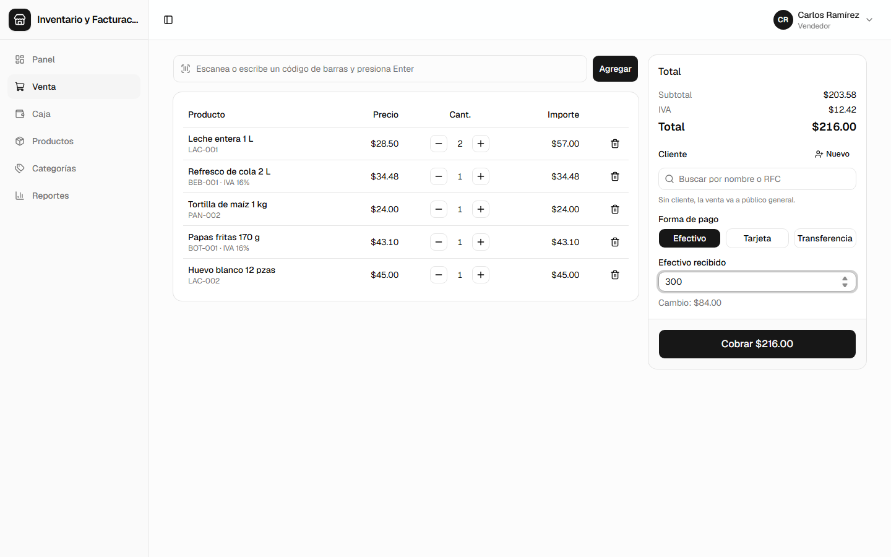
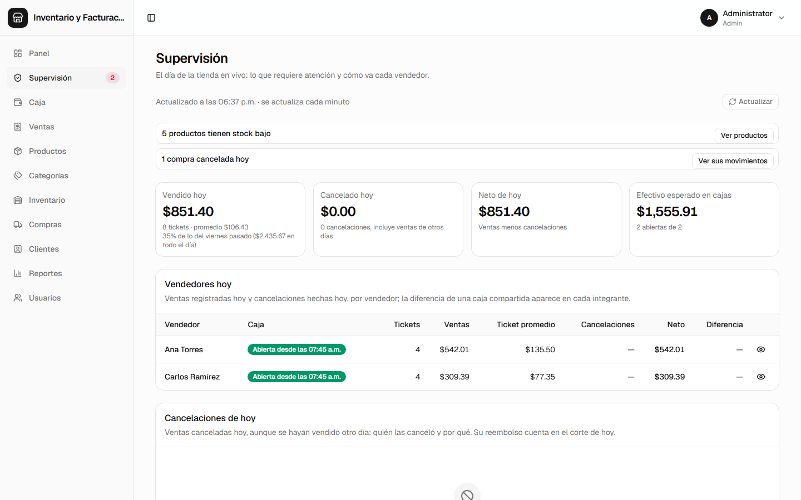
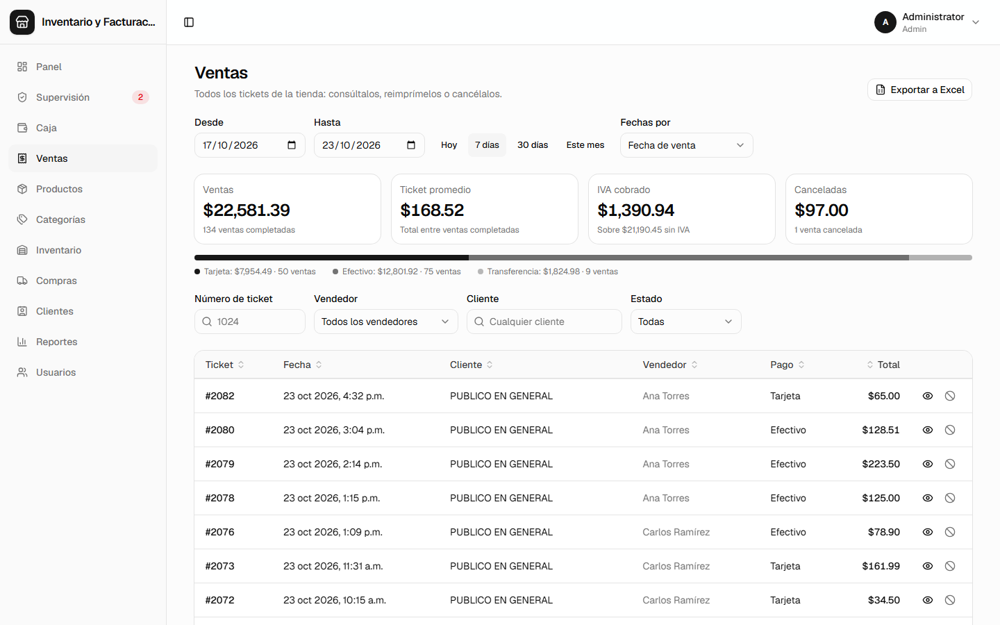
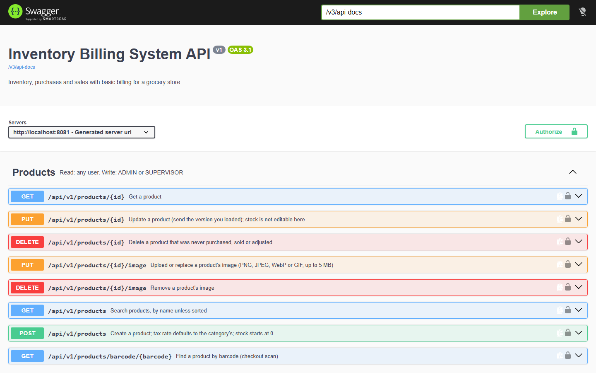

# Sistema de Inventario y Facturación

API REST para una tienda de abarrotes: inventario, compras a proveedores y ventas con facturación básica. Su
cliente web (punto de venta, caja, administración y reportes) está en
[Sistema-de-Inventario-y-Facturacion_Front](https://github.com/IrvinSegura/Sistema-de-Inventario-y-Facturacion_Front).


Contenido: [Características](#características) · [Capturas de pantalla](#capturas-de-pantalla) · [Stack](#stack) ·
[Instalación](#instalación) · [Ejecutar con Docker](#ejecutar-con-docker) · [Despliegue (Render)](#despliegue-render) ·
[Pruebas](#pruebas) · [Variables de entorno](#variables-de-entorno)

## Características

- Autenticación JWT con los roles `ADMIN`, `SUPERVISOR` y `SELLER`.
- Catálogo de productos con categorías, IVA por producto (0% / 16%), búsqueda por código de barras, búsqueda
  general y fotos de producto (PNG, JPEG, WebP o GIF, validadas por contenido; Cloudinary en producción, una carpeta
  local en desarrollo).
- Compras a proveedores con stock seguro ante concurrencia y peticiones idempotentes.
- Clientes, con el cliente genérico del SAT ("PUBLICO EN GENERAL") por defecto.
- Ventas con precios calculados en el servidor e IVA por línea, números de venta consecutivos, `Idempotency-Key`
  obligatorio y cancelación atómica que regresa el stock. El stock nunca queda negativo, aunque varios vendedores
  compitan por la última unidad.
- Cajas: un vendedor abre la caja del día con un fondo inicial (necesario para vender), o un gerente abre una para
  un vendedor o una compartida para varios; su responsable la cierra con el efectivo contado, y queda registrado el
  efectivo esperado y el sobrante o faltante. Los gerentes no tienen caja ni venden.
- Ajustes manuales de stock con motivo obligatorio (opcionalmente idempotentes) y un kardex de cada cambio, por
  producto o por tipo en toda la tienda.
- Reportes: ventas por periodo (totales, formas de pago, vendedores, productos más vendidos, desglose diario en la
  zona horaria de la tienda y utilidad bruta para gerentes), corte de caja diario por forma de pago con las cajas
  del día y una lista de productos por resurtir. Los vendedores solo ven sus propias ventas. Los gerentes además
  tienen ventas por producto (con costo y utilidad bruta, o los productos en existencia que no se vendieron),
  ventas por cliente registrado y un resumen de compras (proveedores, productos más comprados, desglose diario).
- Costo de lo vendido: cada compra actualiza el costo promedio ponderado del producto, y cada línea de venta
  conserva el costo que tenía al venderse.

Diseño de la base de datos: [docs/data-model.md](docs/data-model.md).

## Capturas de pantalla

Los módulos de la API tal como los muestra el cliente web, con datos de demostración (más en el
[README del cliente web](https://github.com/IrvinSegura/Sistema-de-Inventario-y-Facturacion_Front#capturas-de-pantalla)).

| Punto de venta | Supervisión |
|---|---|
|  |  |

| Ventas | Inventario |
|---|---|
|  |  |

| Reporte de ventas | Corte de caja |
|---|---|
|  |  |

Todos los endpoints están documentados con OpenAPI y se pueden probar desde Swagger UI:



## Stack

Java 21 · Spring Boot 4 · Spring Security · PostgreSQL 17 · Flyway · Docker · Testcontainers

## Instalación

Requiere JDK 21, Docker (Docker Desktop en Windows y macOS) y Git. No hace falta instalar PostgreSQL: al arrancar,
la app levanta el servicio `postgres` de `compose.yaml` y lo deja corriendo.

1. Clona el repositorio:

   ```bash
   git clone https://github.com/IrvinSegura/Sistema-de-Inventario-y-Facturacion.git
   cd Sistema-de-Inventario-y-Facturacion
   ```

2. Copia `.env.example` a `.env` (ignorado por git) y llena al menos:

   ```dotenv
   # Base64 de al menos 32 bytes aleatorios: openssl rand -base64 32
   JWT_SECRET=...
   # El primer admin, se crea al arrancar si no existe ninguno
   ADMIN_EMAIL=admin@example.com
   ADMIN_PASSWORD=...
   ```

   Correo, SMS y Cloudinary son opcionales: sin ellos, los códigos para restablecer la contraseña se escriben en el
   log y las imágenes de producto se guardan en `uploads/images` (ver [Variables de entorno](#variables-de-entorno)).

3. Con Docker corriendo, inicia la API (`mvnw.cmd spring-boot:run` en Windows sin Git Bash):

   ```bash
   ./mvnw spring-boot:run
   ```

   La primera vez descarga las dependencias y la imagen de PostgreSQL; después Flyway crea el esquema con las
   categorías por defecto y el cliente genérico.

4. Revísala en http://localhost:8080/actuator/health y explora la API en http://localhost:8080/swagger-ui.html.
   Para llamar a los endpoints protegidos, inicia sesión con `POST /api/v1/auth/login` usando el admin del paso 2
   y pega el `accessToken` en **Authorize**.

5. Opcionalmente, ejecuta el [cliente web](https://github.com/IrvinSegura/Sistema-de-Inventario-y-Facturacion_Front#instalación)
   en http://localhost:5173, que esta API permite por defecto.

## Ejecutar con Docker

La imagen empaqueta solo la app (las pruebas corren en CI). Contra cualquier PostgreSQL:

```bash
docker build -t inventory-billing-system .
docker run -p 8080:8080 -e SPRING_PROFILES_ACTIVE=prod -e DB_HOST=... -e DB_NAME=... -e DB_USER=... -e DB_PASSWORD=... -e JWT_SECRET=... -e ADMIN_EMAIL=... -e ADMIN_PASSWORD=... inventory-billing-system
```

## Despliegue (Render)

`render.yaml` es un Blueprint de Render: la API (Docker, plan gratuito) más un PostgreSQL 17 privado.

1. En Render: **New > Blueprint** y elige este repositorio.
2. Llena `ADMIN_EMAIL` y `ADMIN_PASSWORD` cuando lo pida; `JWT_SECRET` se genera solo y las variables de la base de
   datos se conectan automáticamente.
3. Cada push a `main` se despliega cuando pasa el CI; `/actuator/health` (incluida la base de datos) valida cada
   despliegue.

En el plan gratuito el servicio se duerme tras unos minutos sin uso (la primera petición tarda cerca de un minuto)
y la base de datos gratuita expira después de un tiempo limitado; Flyway recrea el esquema en una nueva.

El inicio de sesión y el restablecimiento de contraseña tienen límite de peticiones por dirección del cliente, en
memoria (`app.rate-limit`), así que corre una sola instancia; escalar a varias requiere un almacén compartido para
los límites.

## Pruebas

```bash
./mvnw verify
```

## Variables de entorno

| Variable | Descripción |
|---|---|
| `SPRING_PROFILES_ACTIVE` | `prod` en contenedores (lee las variables de abajo) |
| `DB_HOST` / `DB_PORT` / `DB_NAME` / `DB_USER` / `DB_PASSWORD` | Conexión a PostgreSQL (`prod`; el puerto por defecto es 5432) |
| `CORS_ALLOWED_ORIGINS` | Orígenes del cliente web separados por comas (por defecto `http://localhost:5173`; ninguno en `prod` si no se define) |
| `PORT` | Puerto HTTP (`prod`; por defecto 8080, Render lo define) |
| `JWT_SECRET` | Base64, al menos 32 bytes (`openssl rand -base64 32`) |
| `JWT_MAX_SESSION_AGE` | Cuánto dura una sesión desde el inicio de sesión, sin importar cuántas veces se renueve (por defecto `7d`; p. ej. `12h`) |
| `ADMIN_EMAIL` / `ADMIN_PASSWORD` | Admin inicial, se crea si no existe ninguno |
| `MAIL_HOST` / `MAIL_PORT` / `MAIL_USERNAME` / `MAIL_PASSWORD` / `MAIL_FROM` | SMTP para los códigos de restablecimiento de contraseña y los avisos de cambios en la cuenta por correo (opcional; el puerto por defecto es 587 con STARTTLS) |
| `TWILIO_ACCOUNT_SID` / `TWILIO_AUTH_TOKEN` / `TWILIO_FROM_NUMBER` | Twilio para los códigos de restablecimiento por SMS (opcional; número en E.164) |
| `CLOUDINARY_CLOUD_NAME` / `CLOUDINARY_API_KEY` / `CLOUDINARY_API_SECRET` | Cloudinary para las imágenes de producto (obligatorio para subir imágenes en `prod`; en otros perfiles van a `uploads/images`) |
| `IMAGES_BASE_URL` | URL pública de la carpeta local de imágenes (por defecto `http://localhost:8080/images`; no se usa con Cloudinary) |
| `CASH_DRAWER_UNBALANCED_THRESHOLD` | Pesos de faltante o sobrante a partir de los cuales una caja cerrada cuenta como descuadrada en el corte de caja (por defecto `50.00`) |

Sin configuración de SMTP o Twilio, los códigos de ese canal no se envían; fuera de `prod` se escriben en el log
para poder probar el flujo en local.
Sin configuración de Cloudinary, la subida de imágenes responde 503 en `prod` (el disco de Render se borra en cada
despliegue).
