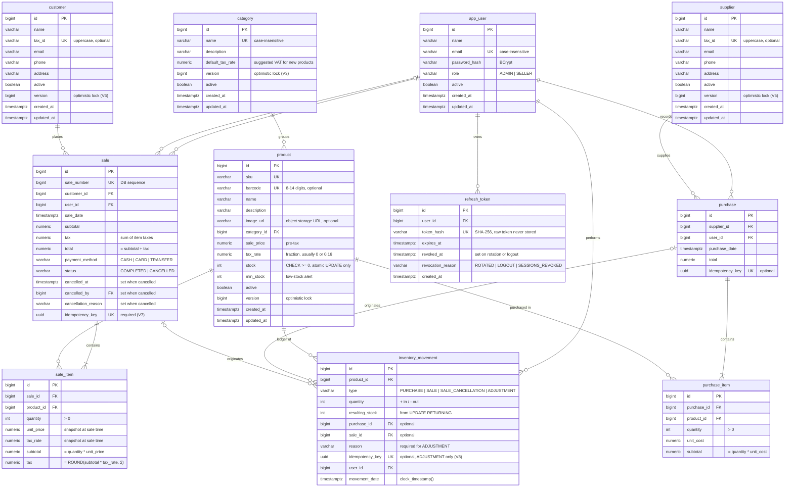

# Data Model

PostgreSQL 17. The schema changes only through Flyway migrations (`src/main/resources/db/migration`).

## ER Diagram

## Design Decisions

| Decision | Why |
|---|---|
| Stock decremented with `UPDATE ... SET stock = stock - :qty WHERE id = :id AND stock >= :qty RETURNING stock`, backed by `CHECK (stock >= 0)` | Two sellers selling the last unit at once: only one succeeds. |
| `Product.stock` mapped `insertable = false, updatable = false` | Otherwise an admin editing the price could overwrite stock with a stale value and silently undo sales. |
| `version` on product, category, supplier and customer; clients send the version they loaded | Concurrent catalog edits are detected (409) instead of silently overwritten; doesn't cover stock, so it never conflicts with sales. |
| Category locked before product: FOR SHARE to assign/activate a product, FOR UPDATE to deactivate | An active product never ends up in an inactive category, even under concurrent edits. |
| Purchases lock the supplier and sales the customer `FOR SHARE` before any product | The supplier or customer can't be deactivated while a document that uses it is being recorded. |
| Lock products in `product_id` order; `lock_timeout = 5s` | Prevents deadlocks between multi-product sales and endless waits on hot rows. |
| Stock written only by `InventoryMovementRepository`: one CTE per line (`UPDATE product ... AND active RETURNING stock` + `INSERT inventory_movement`) | The stock change and its movement happen while the row is locked, so `resulting_stock` is exact under concurrency and no movement can be forgotten. |
| Idempotency: transaction-scoped advisory lock on `scope:key`, then lookup; same key with a different payload → 409 | Concurrent retries (double click) record exactly one document. |
| `idempotency_key` on sale (required, V7) and purchase (optional) | A double click or retry returns the existing document instead of creating a duplicate. Double clicks are common at the checkout; purchases are recorded only by admins. A sale key reused by another seller is a 409, so it never reveals their sale. |
| Atomic cancellation (`UPDATE sale SET status = 'CANCELLED', cancelled_at, cancelled_by, cancellation_reason WHERE id = :id AND status = 'COMPLETED'`) + unique index per (sale, product, type) | Concurrent cancellations can't return stock twice; who, when and why is always recorded (enforced by `ck_sale_status`). |
| Only ADMIN changes a customer's tax ID or `active` flag (403 for sellers) | Sales reference the customer, so past receipts show its current tax ID; deactivating it blocks every checkout. Sellers still register customers and fix contact data. |
| Cancellation returns stock even to products deactivated after the sale | The goods are physically back on the shelf; the product just can't be sold until it's reactivated. |
| `barcode` (optional, unique, 8-14 digits) separate from `sku` | Grocery items are sold by scanning; `sku` stays as the internal code, also for unlabeled items. |
| `image_url` only; images live in object storage (Cloudinary/S3) | Binary files bloat and slow down the DB. |
| `payment_method` on sale | Needed for reports and cash closing. |
| `resulting_stock` from `RETURNING`; `movement_date` uses `clock_timestamp()` | The ledger stays consistent and correctly ordered under concurrency. |
| `sale_number` from a DB sequence, mapped with `@Generated(event = INSERT)` | `MAX()+1` duplicates numbers; `@Generated` reads the value back. |
| `unit_price` and `tax_rate` copied into `sale_item`, read before the product row is locked | Past sales keep their original price and tax. A price edited at the same instant leaves the sale with the price the checkout saw, which is acceptable. |
| Seeded grocery categories with `default_tax_rate` (Pantry, Dairy, Bakery 0%; Beverages, Snacks, Cleaning, Personal Care 16%) | Pre-fills the product VAT so classification errors are less likely; each product can still override it. |
| Refresh tokens stored as SHA-256 hashes, rotated on every use; reuse of a `ROTATED` token revokes all of the user's sessions; expired ones deleted daily | Stolen refresh tokens are detected without logging users out for a stale logged-out token; a DB leak doesn't expose usable tokens. |
| Emails stored lowercase (`CHECK (email = LOWER(email))`) with a plain unique index | Case-insensitive uniqueness and indexed login lookups. |
| VAT rate per product (`tax_rate`: 0% basic food, 16% general); tax computed and rounded per line (HALF_UP); `sale.tax` = sum of line taxes | Mexican grocery store: sugar or rice pay 0%, soda or snacks 16%. |
| Money as `NUMERIC(12,2)` / `BigDecimal`; `sale_price` is pre-tax | No floating-point rounding errors; totals computed server-side. |
| Manual adjustments are signed `ADJUSTMENT` movements (one atomic CTE with `stock + qty >= 0`), allowed on inactive products | Shrinkage, damage and count differences are corrected without ever going negative; discontinued products still need their remaining units written off. |
| Optional `Idempotency-Key` on adjustments, stored on the movement (V8, partial unique index, only for `ADJUSTMENT`) | A retried "-5 damaged" must not remove 10 units. Adjustments have no document table, so the key lives on the movement; the partial index keeps sale and purchase rows out. |
| Stock ledger read per product (`productId` required, 404 if the product doesn't exist), newest first, in one `REPEATABLE READ` snapshot | Uses `ix_inventory_movement_product_date`; a store-wide ledger would scan the most write-heavy table. The page and its total count come from the same snapshot. Offset paging over a growing ledger can shift: clients keep the first request's `to` while paging. |
| `product.stock` is `INTEGER` | Overflow needs over 2.1 billion units of one product; accepted, it would surface as a generic 409. |
| Sales reports aggregate in SQL inside one `REPEATABLE READ` read-only transaction with a 10 s timeout; the period is validated before it starts | Totals and breakdowns come from the same snapshot, so they agree even while sales are being recorded; no sale rows are loaded into memory. A heavy or invalid report never holds a pool connection the checkout needs. |
| Report days follow `app.store.time-zone` (a region ID such as `America/Mexico_City`; offsets are rejected); periods are inclusive calendar days, up to 366, between 2000-01-01 and 9999-12-30 | Dates are stored in UTC, but "sales on Oct 1" means the store's local day. PostgreSQL converts both the period bounds and each sale's day (`AT TIME ZONE`), so filter and daily breakdown always agree; it reads offsets like `-06:00` with an inverted sign. |
| Sales by period count only `COMPLETED` sales; cancelled ones are reported separately, on the day of the sale | Cancelled sales returned their stock and money, but the count is still useful for audits. A cancellation can change an already closed day; a cash-closing report by `cancelled_at` would be a separate view. |
| Low-stock report: out-of-stock products first, then furthest below `min_stock` | A product with 0 units can't be sold at all, even if its shortage is smaller. |
| Sales are cancelled, catalogs soft-deleted (`active`) | History is never broken. |
| Seeded "PUBLICO EN GENERAL" customer (`XAXX010101000`), looked up by tax ID constant and read-only through the API | Every sale has a customer, as Mexican invoicing requires; sales without `customerId` fall back to it, so it can't be renamed or deactivated. |
| First ADMIN created at startup from `ADMIN_EMAIL` / `ADMIN_PASSWORD` | A password hash in a migration would be a versioned credential. |
| `BIGINT IDENTITY` ids, `TIMESTAMPTZ` dates | PostgreSQL standard; time zone-safe reports. |

## Indexes

Details live in `V1__initial-schema.sql`. Criteria:

- Every queried FK is indexed. The `UNIQUE (document_id, product_id)` constraints on line items also cover the document FK.
- Trigram (GIN, `pg_trgm`) indexes on `lower(name)` and `lower(sku)` for product substring search (V4).
- Date indexes for reports: `sale(sale_date)`, `purchase(purchase_date)`, `sale(user_id, sale_date)` and `inventory_movement(product_id, movement_date)`.
- `stock` is not indexed: it's the hottest column and the low-stock report scans a small catalog.

## Role Permissions

| Action | ADMIN | SELLER |
|---|:---:|:---:|
| Manage users | ✅ | ❌ |
| Manage products, categories, suppliers | ✅ | ❌ |
| View products and stock | ✅ | ✅ |
| Record purchases | ✅ | ❌ |
| Create customers and edit their contact data | ✅ | ✅ |
| Change a customer's tax ID or deactivate it | ✅ | ❌ |
| Record sales | ✅ | ✅ |
| View sales | ✅ | Own sales only |
| Cancel sales | ✅ | ❌ |
| Manual stock adjustments | ✅ | ❌ |
| View the stock ledger | ✅ | ❌ |
| Sales reports | ✅ | Own sales only |
| Low-stock report | ✅ | ✅ |
