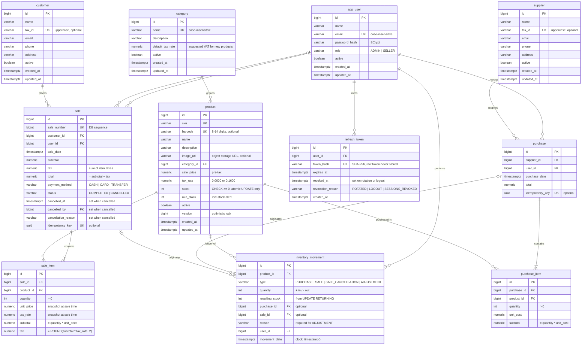

# Data Model

PostgreSQL 17. The schema changes only through Flyway migrations (`src/main/resources/db/migration`).

## ER Diagram

## Design Decisions

| Decision | Why |
|---|---|
| Stock decremented with `UPDATE ... SET stock = stock - :qty WHERE id = :id AND stock >= :qty RETURNING stock`, backed by `CHECK (stock >= 0)` | Two sellers selling the last unit at once: only one succeeds. |
| `Product.stock` mapped `insertable = false, updatable = false` | Otherwise an admin editing the price could overwrite stock with a stale value and silently undo sales. |
| `version` on product | Optimistic locking for catalog edits; doesn't cover stock, so it never conflicts with sales. |
| Lock products in `product_id` order; `lock_timeout = 5s` | Prevents deadlocks between multi-product sales and endless waits on hot rows. |
| `idempotency_key` on sale and purchase | A double click or retry returns the existing document instead of creating a duplicate. |
| Atomic cancellation (`UPDATE sale SET status = 'CANCELLED', cancelled_at, cancelled_by, cancellation_reason WHERE id = :id AND status = 'COMPLETED'`) + unique index per (sale, product, type) | Concurrent cancellations can't return stock twice; who, when and why is always recorded (enforced by `ck_sale_status`). |
| `barcode` (optional, unique, 8-14 digits) separate from `sku` | Grocery items are sold by scanning; `sku` stays as the internal code, also for unlabeled items. |
| `image_url` only; images live in object storage (Cloudinary/S3) | Binary files bloat and slow down the DB. |
| `payment_method` on sale | Needed for reports and cash closing. |
| `resulting_stock` from `RETURNING`; `movement_date` uses `clock_timestamp()` | The ledger stays consistent and correctly ordered under concurrency. |
| `sale_number` from a DB sequence, mapped with `@Generated(event = INSERT)` | `MAX()+1` duplicates numbers; `@Generated` reads the value back. |
| `unit_price` and `tax_rate` copied into `sale_item` | Past sales keep their original price and tax. |
| Seeded grocery categories with `default_tax_rate` (Pantry, Dairy, Bakery 0%; Beverages, Snacks, Cleaning, Personal Care 16%) | Pre-fills the product VAT so classification errors are less likely; each product can still override it. |
| Refresh tokens stored as SHA-256 hashes, rotated on every use; reuse of a `ROTATED` token revokes all of the user's sessions; expired ones deleted daily | Stolen refresh tokens are detected without logging users out for a stale logged-out token; a DB leak doesn't expose usable tokens. |
| Emails stored lowercase (`CHECK (email = LOWER(email))`) with a plain unique index | Case-insensitive uniqueness and indexed login lookups. |
| VAT rate per product (`tax_rate`: 0% basic food, 16% general); tax computed and rounded per line (HALF_UP); `sale.tax` = sum of line taxes | Mexican grocery store: sugar or rice pay 0%, soda or snacks 16%. |
| Money as `NUMERIC(12,2)` / `BigDecimal`; `sale_price` is pre-tax | No floating-point rounding errors; totals computed server-side. |
| Sales are cancelled, catalogs soft-deleted (`active`) | History is never broken. |
| Seeded "PUBLICO EN GENERAL" customer (`XAXX010101000`), looked up by tax ID constant | Every sale has a customer, as Mexican invoicing requires. |
| First ADMIN created at startup from `ADMIN_EMAIL` / `ADMIN_PASSWORD` | A password hash in a migration would be a versioned credential. |
| `BIGINT IDENTITY` ids, `TIMESTAMPTZ` dates | PostgreSQL standard; time zone-safe reports. |

## Indexes

Details live in `V1__initial-schema.sql`. Criteria:

- Every queried FK is indexed. The `UNIQUE (document_id, product_id)` constraints on line items also cover the document FK.
- Date indexes for reports: `sale(sale_date)`, `purchase(purchase_date)`, `sale(user_id, sale_date)` and `inventory_movement(product_id, movement_date)`.
- `stock` is not indexed: it's the hottest column and the low-stock report scans a small catalog.

## Role Permissions

| Action | ADMIN | SELLER |
|---|:---:|:---:|
| Manage users | ✅ | ❌ |
| Manage products, categories, suppliers | ✅ | ❌ |
| View products and stock | ✅ | ✅ |
| Record purchases | ✅ | ❌ |
| Manage customers | ✅ | ✅ |
| Record sales | ✅ | ✅ |
| Cancel sales | ✅ | ❌ |
| Manual stock adjustments | ✅ | ❌ |
| Reports | ✅ | Own sales only |
